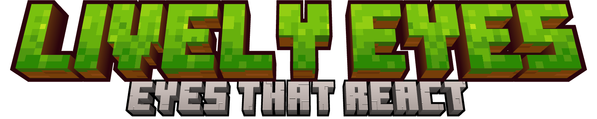
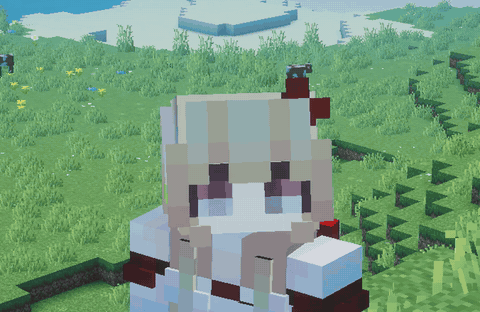
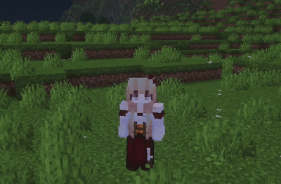
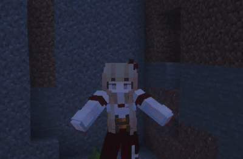
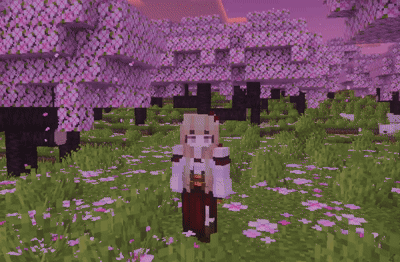
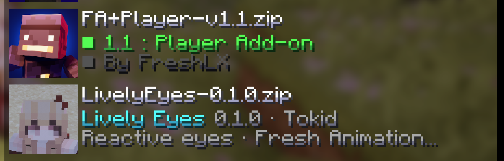

---

**Eyes that notice things.** Lively Eyes gives player models eyes that look around, blink when they need to, and react to what happens to them: a hit, a fall, a long dive, a quiet moment. Made for [Entity Model Features](https://modrinth.com/mod/entitymodelfeatures).

## 🌟 Features

### 👀 Eyes lead, the head follows

Small glances move only the eyes. Look further or faster and the head turns after them while the eyes settle back to the center, the way people actually look around.

  
   
  <em>Eyes lead, the head follows</em>

### 😉 Blinking that reacts

There is no blink timer. Eyes dry out and blink, and wide eyes dry out faster. A scare leaves you tense and blinking more for a while, and low health makes blinks slow and heavy.

  
   
  <em>Getting hit: wide eyes, a flinch and a blink</em>

### 💥 Reactions

- **Hit**: the eyes go wide and the head flinches.
- **Falling**: wide eyes, looking down.
- **Hard landing**: the head dips and the eyes squeeze shut.
- **Coming up from a long dive**: a shake of the head and a few blinks to clear the water.
- **Attack swing**: a small push of the head and a squint.
- **Out of breath**: after a sprint, you pant once you stop.

  
   
  <em>Coming up from a long dive</em>

### 🌦️ Surroundings

Squinting under water, in the rain, in fire, against the sun and in the Nether heat.

### 💤 Idle life

Stand still and your character's eyes wander around. Leave them alone long enough and they get drowsy, nod off, yawn and finally fall asleep; any input wakes them with a start. Eyes close while sleeping in a bed.

  
   
  <em>Standing idle</em>

## 📦 Requirements

- Minecraft 1.21.11, or 26.1 – 26.1.2
- [Entity Model Features](https://modrinth.com/mod/entitymodelfeatures) and [Entity Texture Features](https://modrinth.com/mod/entitytexturefeatures)
- For the eye animations, a skin made for **Fresh Moves** (its eye-slot layout). Head reactions work with any skin.

## 🧩 Compatibility

- **Skin Layers 3D**: works.
- **Fresh Moves itself**, or other packs that replace `player.jem`: not compatible. Use one of them.
- **Fresh Animations Player**: works together. Put Fresh Animations **above** Lively Eyes in the resource pack list.

  
   
  <em>Resource pack order: Fresh Animations above Lively Eyes</em>

## 🔭 Optional: Lively Eyes Bridge (in development)

A resource pack can't tell when you zoom. Lively Eyes Bridge, a Fabric mod still in development, will pass that on: your eyes will squint and blink less while you zoom with Zoomify or a spyglass.

## ❓ FAQ

**The eyes don't move.**

Your skin needs Fresh Moves eye slots. Lively Eyes reads the eye pixels from the same unused parts of the skin texture that Fresh Moves skins use.

**Can other players see it?**

It's a client-side resource pack. You see it on every player whose skin has eye slots; other people see it only if they use Lively Eyes too.

**Does it work on servers?**

Yes. Nothing runs on the server.

All rights reserved unless explicitly stated.